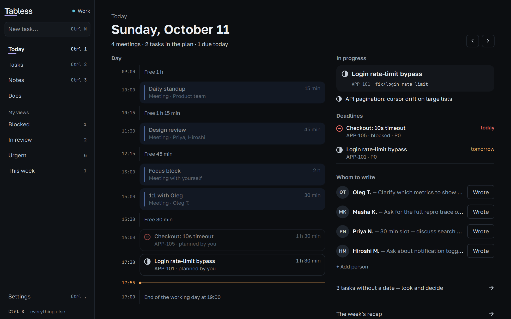
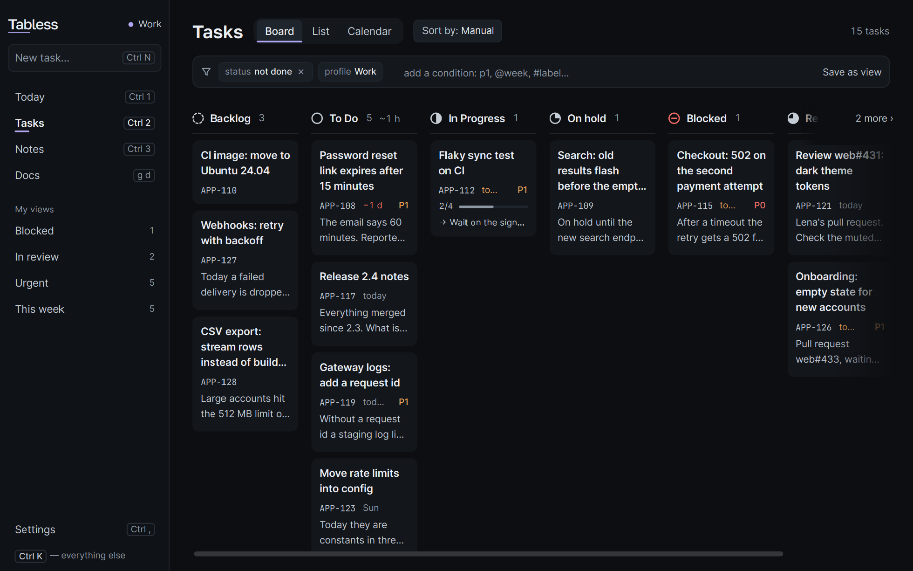
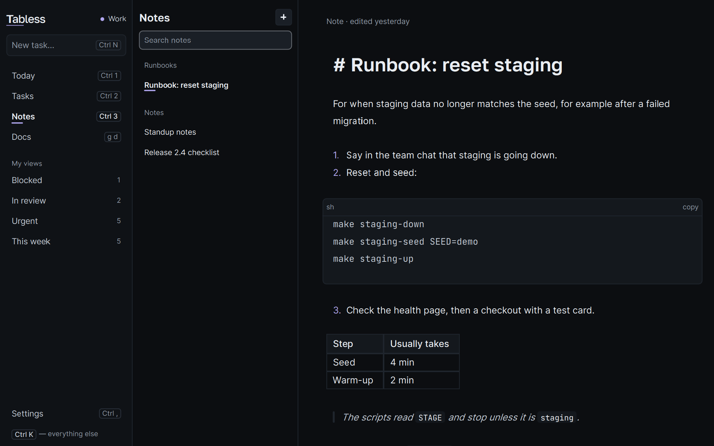
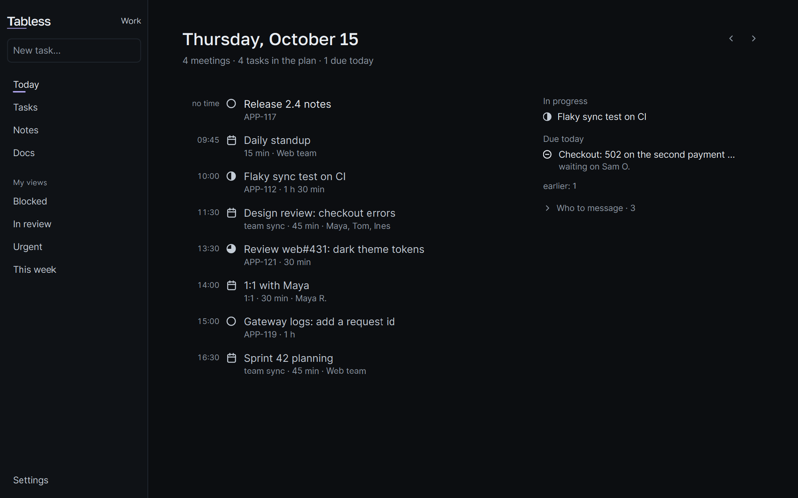
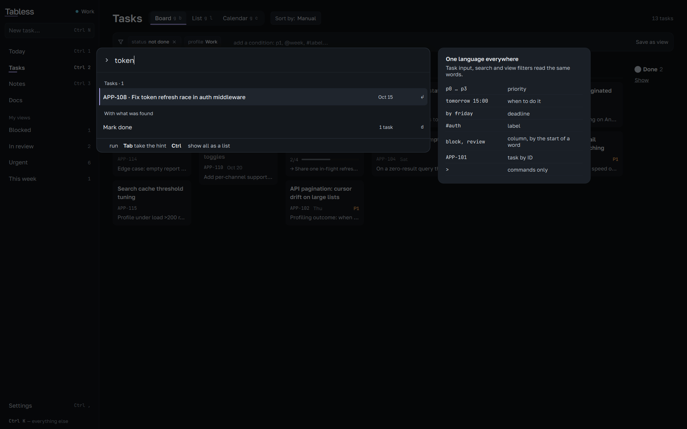

<p align="center">
  <picture>
    <source media="(prefers-color-scheme: dark)" srcset="design/brand-export/lowkey/lowkey-wordmark-on-dark.svg">
    
  </picture>
</p>

<h3 align="center">Quiet by default.</h3>

<p align="center">
  Your tracker tasks, today's meetings and your notes — in one native window, driven from the keyboard.
</p>

<p align="center">
  <a href="https://github.com/sectapunterx/lowkey/releases/latest"><b>Download</b></a> ·
  <a href="https://sectapunterx.github.io/lowkey/">Website</a> ·
  <a href="#docs">Docs</a>
</p>

<p align="center">
  
</p>

<p align="center">
  <a href="https://github.com/sectapunterx/lowkey/releases"></a>
  <a href="LICENSE"></a>
  
</p>

- **12 trackers, one list** — GitHub, GitLab, Jira, Trello, Gitea, Forgejo, Redmine, Todoist, Asana,
  ClickUp, Sentry, Bitbucket. Read-only unless you switch writes on.
- **Capture from any app** — `Ctrl+Shift+Space`, type `review PR tomorrow 11:00 p1 #api`, done.
- **Knows your branch** — check out `APP-112-…` and APP-112 is at the top of the window.
- **Vim-style keys** — `j` `k`, `g b`, `d`, `/`; any layout, every key rebindable.
- **Yours, on disk** — one readable `state.json`. No account, no analytics, works offline. Free, MIT.

<table>
  <tr>
    <td width="50%"><br><sub>Board — one keypress per move</sub></td>
    <td width="50%"><br><sub>Week — meetings and planned tasks</sub></td>
  </tr>
  <tr>
    <td><br><sub>A task opens as a document</sub></td>
    <td><br><sub>Markdown notes linked to tasks</sub></td>
  </tr>
</table>

## Up and running in two minutes

1. **Install** — from [the latest release](https://github.com/sectapunterx/lowkey/releases/latest): Windows
   `setup.exe` or portable `.zip`, macOS `.dmg`, Linux `.AppImage` (Qt inside, nothing else to install).
   Or `scoop bucket add lowkey https://github.com/sectapunterx/lowkey` then `scoop install lowkey`.
2. **Connect a tracker** — Settings → Integrations → **Connect with browser**. A token works everywhere too.
3. **Add your calendar** — paste an `.ics` link from Outlook, Google or iCloud. Read-only.
4. **Press `?`** — every key on one screen.

## A day with it

**Morning.** Today shows the meetings and tasks of the day by the hour, plus what is in progress and due.

**A thought mid-call.** `Ctrl+Shift+Space` over any app. Date, time, priority and label are read from the
words, in English or Russian. `Ctrl+Shift+N` does the same for a note.

**Starting work.** Check out the ticket's branch — the task shows up top with its PR state from your own
`gh` or `glab`, and moves to In Progress (one switch turns that off).

**Your own layer on every ticket.** Private notes, checklist, tags and dates on any tracker task. A sync
never overwrites them, and none of it goes back to the tracker.

**Notes that point at work.** `#APP-112` in a note becomes a link with the task's title. Bring an existing
folder of `.md` files or an Obsidian vault — you see what comes in before anything is copied.

## It never does these without asking

| | |
| --- | --- |
| **Write to your tracker** | Issues come in read-only. Status on card move is a per-tracker switch, off by default, and the issue is re-checked before anything is sent. Titles, descriptions and comments are never written. |
| **Phone home** | No analytics, no crash reports. The update check on start can be turned off; updates install only on your click. |
| **Run in the background** | Only while its window or tray icon is open. Start at login is off. |
| **Lose your work** | Daily backups (newest 20 kept) and a time machine of snapshots you can step back through. |

<p align="center">
  
  <br><sub>The Quiet style — the same day, less on screen</sub>
</p>

## Built for the keyboard

| Key | Does |
| --- | --- |
| `Ctrl+K` | Find anything, run any command |
| `Ctrl+1` `2` `3` | Today · Tasks · Knowledge |
| `g b` · `g l` · `g c` | Board · list · calendar |
| `j` `k` · `h` `l` | Move the cursor |
| `d` · `s` | Done · schedule |
| `y y` · `y b` | Copy task id · branch name |
| `/` | Filter the section you are in |

Keys are read by their place on the keyboard, so they work in any layout. Full map:
[docs/HOTKEYS.md](docs/HOTKEYS.md).

The filter is a small query language — same in board, list and calendar:

```
status:blocked  due:week  is:overdue  priority:p0,p1  branch:login  estimate:>2h  -status:done  bug OR crash
```

<p align="center">
  
</p>

## And from the terminal

```sh
lowkey today                                  # overdue first, then what's on today
lowkey add "fix login tomorrow 14:00 p1 #backend"
lowkey now                                    # the current task — fits a shell prompt
```

Changes show up in the open window at once. On Windows the command is `lowkey-cli`. Starship snippet and
the rest: [docs/CLI.md](docs/CLI.md).

## Not for you if

- you need a shared team board — this is your desk, the team's tracker stays the shared place;
- you want something to plan your day for you — it shows the facts, the decisions stay yours;
- you need live sync between machines — for now it is export and import;
- you work from a phone — there is no mobile or web version.

## Docs

- [Keyboard](docs/HOTKEYS.md) — every key, and how to rebind them
- [Trackers](docs/INTEGRATIONS.md) — connecting each one; what is read, what may be written
- [Data and backups](docs/DATA.md) — where files live, restores, moving between machines
- [Command line](docs/CLI.md) · [Tutorial](docs/TUTORIAL.md)
- [Building from source](docs/BUILDING.md) — Qt 6.9+, C++20 · [Contributing](CONTRIBUTING.md)

Bug reports and pull requests are welcome — please attach `logs/lowkey.log`.

MIT — see [LICENSE](LICENSE). Bundled fonts (Golos Text, JetBrains Mono) are under the SIL OFL 1.1, see
[THIRD_PARTY_NOTICES.md](THIRD_PARTY_NOTICES.md).
